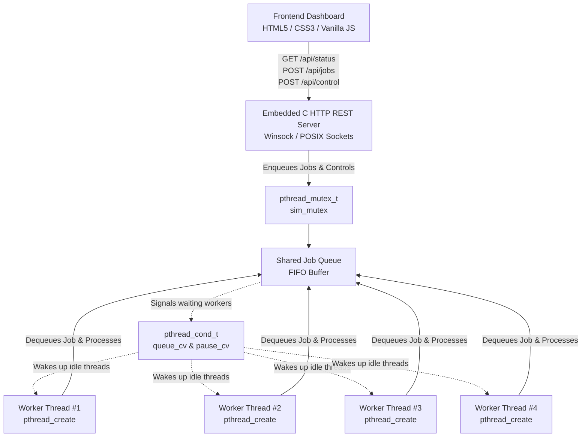

# 🏭 Thread Factory — OS Mini Simulation

An interactive, educational Operating Systems simulation demonstrating concurrent job processing using **POSIX Threads (`pthreads`)**, mutual exclusion (`pthread_mutex_t`), and condition variables (`pthread_cond_t`) in C, connected to a clean, modern factory-themed web dashboard.

---

## 📌 Project Overview

In multi-core operating systems, multithreading enables concurrent execution of tasks, dramatically reducing wall-clock turnaround times. **Thread Factory** models an industrial manufacturing plant where:
- A **Producer** (the user or batch dispatcher) submits jobs with varying durations to a central FIFO **Job Queue**.
- A pool of **POSIX Worker Threads** concurrently dequeues and processes tasks from the shared queue.
- **Mutual Exclusion (`pthread_mutex_t`)** protects the shared queue from race conditions during concurrent enqueue/dequeue operations.
- **Condition Variables (`pthread_cond_t`)** prevent wasteful CPU spinning (busy-waiting) by putting idle worker threads to sleep when the queue is empty and waking them instantly when new jobs arrive.
- The **Dashboard** computes and displays the **Concurrency Speedup Factor** in real-time, quantitatively comparing sequential vs. concurrent execution times.

---

## 🏛️ System Architecture



---

## 🔬 Core Operating Systems Concepts Demonstrated

| OS Concept | Implementation in C Backend | Educational Takeaway |
| :--- | :--- | :--- |
| **Thread Creation** | `pthread_create(&worker->tid, NULL, worker_routine, worker)` | Shows how lightweight execution contexts share memory space within the same process. |
| **Mutual Exclusion** | `pthread_mutex_lock(&g_sim.sim_mutex)`<br/>`pthread_mutex_unlock(&g_sim.sim_mutex)` | Enforces atomic access to the critical section (job queue, counters), preventing data corruption. |
| **Condition Variables** | `pthread_cond_wait(&g_sim.queue_cv, &g_sim.sim_mutex)`<br/>`pthread_cond_signal(&g_sim.queue_cv)` | Eliminates busy-waiting by suspending idle threads until notified, minimizing CPU utilization. |
| **Concurrency Speedup** | $Speedup = \frac{T_{sequential}}{T_{wall\_clock}} = \frac{\sum t_i}{T_{elapsed}}$ | Real-time measurement demonstrating Amdahl's Law and parallel throughput advantages. |
| **State Machine** | `sim_start()`, `sim_pause()`, `sim_resume()`, `sim_reset()` | Demonstrates synchronization control over running concurrent worker threads. |

---

## 📁 Project Structure

```text
c:\AProjects\OS\
├── backend/
│   ├── factory_common.h   # Core data types, mutex/CV definitions, logging prototypes
│   ├── queue.h            # Job queue, completed archive, and log ring buffer headers
│   ├── queue.c            # Thread-safe FIFO queue operations
│   ├── worker_pool.h      # Worker thread pool lifecycle and simulation controls header
│   ├── worker_pool.c      # POSIX pthread routines, job processing slices, synchronization
│   ├── http_server.h      # HTTP Server header
│   ├── http_server.c      # Sockets (Winsock/BSD), REST API routing, and static file serving
│   └── main.c             # Program entry point, signal handlers, and initialization
├── frontend/
│   ├── index.html         # Modern factory dashboard with KPIs, cards, queue, and logs
│   ├── css/
│   │   └── style.css      # Precision light theme with industrial blue accents
│   └── js/
│       └── app.js         # Reactive JavaScript controller polling backend state
├── build.bat              # 1-click Windows compilation script
├── run.bat                # 1-click Windows launch script (starts backend & opens browser)
├── Makefile               # Cross-platform Makefile (Windows / Linux / macOS)
├── server.py              # Optional Python runner / fallback script
└── README.md              # Project documentation
```

---

## 🚀 How to Compile and Run

### Option 1: Quick Windows 1-Click Launch (Recommended)
Double-click `run.bat` or execute in PowerShell / Command Prompt:
```powershell
.\run.bat
```
*This automatically compiles `factory_server.exe` (if not already compiled), opens your default web browser to `http://localhost:8080/`, and runs the C pthread backend.*

### Option 2: Manual Build with GCC
```powershell
# Compile backend
gcc backend/main.c backend/queue.c backend/worker_pool.c backend/http_server.c -Ibackend -lpthread -lws2_32 -O2 -o factory_server.exe

# Run backend executable on port 8080
.\factory_server.exe 8080
```
Then open your browser to **[http://localhost:8080/](http://localhost:8080/)**.

### Option 3: Cross-Platform Build (Linux / macOS)
```bash
# Build using standard make
make

# Run the server
./factory_server 8080
```

### Option 4: Python Runner
```powershell
python server.py
```

---

## 📡 REST API Reference

The embedded C HTTP server exposes the following REST endpoints:

| Endpoint | Method | Description | Sample Request / Response |
| :--- | :---: | :--- | :--- |
| `/api/status` | `GET` | Returns full simulation state, worker states, queue items, and logs. | `{"is_running": true, "worker_count": 4, "speedup_ratio": 3.12, ...}` |
| `/api/jobs` | `POST` | Enqueues a new job with name and duration. | `{"name": "Laser Etch", "duration": 2.5}` $\rightarrow$ `{"success": true, "job_id": 5}` |
| `/api/control` | `POST` | Controls simulation state (`start`, `pause`, `resume`, `reset`, `set_workers`). | `{"action": "pause"}` or `{"action": "set_workers", "count": 4}` |
| `/api/batch` | `POST` | Enqueues a predefined batch of sample factory jobs. | `{"count": 4}` or `{"count": 8}` |

---

## 🎯 College Demonstration Walkthrough (Viva / Presentation Guide)

1. **Start the Simulation:**
   - Notice the default jobs in the **Job Queue** and all workers in the **IDLE** state waiting on condition variables.
   - Click **Start Simulation**.
   - Watch the active workers immediately wake up, acquire the mutex, dequeue jobs, and process them in parallel.

2. **Demonstrate Concurrency & Speedup:**
   - Observe how 4 workers process jobs simultaneously (e.g. four 3-second jobs finish in ~3 seconds total rather than 12 seconds sequentially).
   - Point out the **Concurrency Speedup Factor** KPI (e.g. `~3.5x Speedup`), proving the multi-core advantage.

3. **Demonstrate Dynamic Worker Scaling:**
   - Switch worker thread count from `4` to `1` (sequential mode) or `8` (high parallelism).
   - Show how the number of active worker cards dynamically updates.

4. **Demonstrate Thread Synchronization & State Control:**
   - Click **Pause**: All busy threads pause their execution slices and idle threads remain asleep.
   - Click **Resume**: All threads resume execution seamlessly without dropped tasks.
   - Click **Reset**: Resets all metrics and clears the queue.

5. **Examine Real-Time Execution Logs:**
   - Open the **Execution Logs** console at the bottom-right.
   - Filter by **Mutex** to show mutex lock acquisitions and releases.
   - Filter by **Condition Var** to show how threads sleep when the queue is empty and wake upon new job arrivals.
